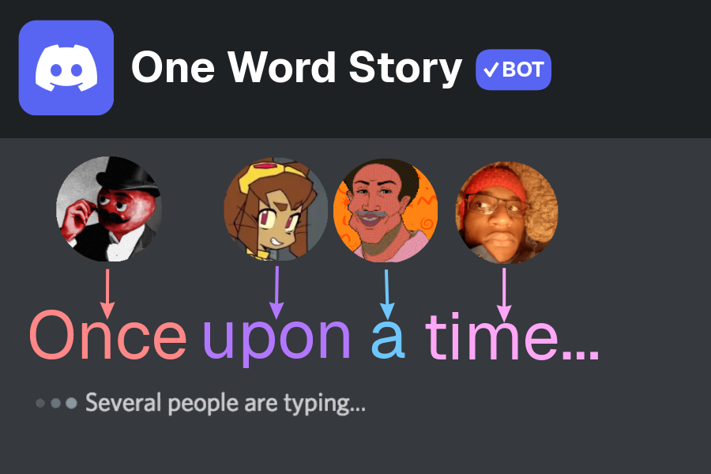

# 📖 Story Bot

A Discord bot (built with [Bun](https://bun.sh) + [discord.js](https://discord.js.org) + [@napi-rs/canvas](https://github.com/Brooooooklyn/canvas)) that turns a channel into a collaborative storybook.

Users each contribute **one word at a time** — first the **title**, then the story itself. Their messages are deleted and folded into a single bot message containing a freshly rendered image of the story so far — every word sitting beneath a small circular avatar and painted in a pastel color unique to its author.

When the story is done, any contributor can run `/endstory` and the whole story is re-rendered in plain ink across an open book — no avatars, no colors.

---

## 📣 Bot Invite
Invite the bot to your server:
> https://discord.com/oauth2/authorize?client_id=1564837963077128272



## ✨ Features

- **One word per message.** Multi-word messages are rejected with a self-deleting notice.
- **Word-by-word titles.** The title is written one word at a time, too, and closed with a colon (`:`). Every title word sits under its author's avatar.
- **Live-rendered story card.** Every contribution re-renders the story as a PNG.
- **Per-user identity.** Each author gets
  - a deterministic pastel color (stable across restarts), and
  - their avatar shown as a small circle directly above each of their words.
- **Fairness rule.** Admins can require that N *other* users write before a user may go again (prevents one person from writing the whole title or story).
- **Auto-cleanup.** User messages are deleted; the channel stays a clean canvas.
- **Book finale.** `/endstory` (any contributor) renders the finished story on an open book in plain serif ink.

---

## 📜 How it works

1. An admin runs `/setchannel #story`. The bot posts a hint that the **next words will form the title**.
2. Users write the **title one word per message**. Each title word appears on the live card in large letters with its author's avatar above it.
3. The title is closed with a colon (see below). From then on, everyone adds **one word per message** to the story itself. The card updates in place each time.
4. Any user who has contributed (title words included) can run `/endstory` once the title is closed. The live card is replaced by the finished book, which is **pinned** to the channel. The contributor bar at the bottom of the book shows each author's avatar, pastel color, and share of the words.
5. The next message in the channel starts a **new story** — beginning with a fresh title.

### The title

- The **first messages** in the story channel are the title, written **one word per message** (just like the story).
- **Closing the title:** a title ends when
  - a word **ends in a colon** — e.g. `Dragons:` adds the word *Dragons* and closes the title (the colon itself is not shown), **or**
  - someone sends a **lone `:`** as a standalone message, which closes the title without adding a word.
- A title needs at least one word before it can be closed, and may be at most 80 characters in total (spaces included). If the next word wouldn't fit, send a lone `:` to end it.
- Everything written after the title is closed is the story itself, and colons are ordinary characters again.
- Title words follow the same rules as story words: one word per message, the 3-second cooldown, and the "min users" rule (below). They also count as contributions for `/endstory` and the contributor bar.
- On the live card every title word has its author's avatar **above** it (in cream lettering, separated from the story by a divider). On the finished book the title is rendered in large serif letters at the top of the first page with no avatars.
- Stories whose title was set before this update (a single multi-word message) keep working: the old title is split into words, shown with the same avatar-above-word layout, and treated as already closed.

### The "min users" rule

`/setminusers N` means: **at least N *distinct other* users must have written a word since your last word** before you may write again.

| `minUsers` | Effect |
|-----------|--------|
| `0` | No restriction — one person can write back-to-back. |
| `1` | At least one other person must go between your words. |
| `2` | At least two different people must go between your words. |

This applies to title words and to the closing `:` as well. The very first word of a story is always allowed.

---

## 📦 Requirements

- [Bun](https://bun.sh) `>= 1.1`
- A Discord bot application
- A system font (the renderer uses `sans-serif` and `serif`; on minimal Linux images install `fontconfig` + `dejavu-fonts`)

---

## 🚀 Setup

### 1. Create the Discord application

1. Go to the [Discord Developer Portal](https://discord.com/developers/applications) → **New Application**.
2. Open the **Bot** tab and click **Reset Token** → copy the token.
3. Under **Privileged Gateway Intents**, enable:
   - ✅ **Message Content Intent**
   - ✅ Server Members Intent *(optional, not required)*

### 2. Invite the bot

Use the OAuth2 URL generator with scopes `bot` + `applications.commands`, or open:

```
https://discord.com/oauth2/authorize?client_id=YOUR_CLIENT_ID&permissions=2147609600&scope=bot%20applications.commands
```

`2147609600` grants:

| Permission | Why |
|-----------|-----|
| View Channels | see the story channel |
| Send Messages | post the story card |
| Manage Messages | delete user words |
| Embed Links | — |
| Attach Files | upload the rendered image |
| Read Message History | edit the story card |
| Use Application Commands | slash commands |

> The bot must be **above** users in the role hierarchy, or it needs **Manage Messages** explicitly, to delete their messages.

### 3. Configure

```bash
cp .env.example .env
# edit .env and paste your token
```

```env
TOKEN=your-bot-token-here
```

### 4. Install & run

```bash
bun install
bun start        # or: bun run dev  (auto-reload)
```

On first launch the bot registers its slash commands globally (may take a few minutes to appear).

---

## 🎮 Commands

| Command | Who | Description |
|---------|-----|-------------|
| `/setchannel <channel>` | Manage Server | Sets the channel where the story is written. |
| `/setminusers <num>` | Manage Server | Number of *other* users who must write before a user can write again (`0`–`50`). |
| `/endstory` | Any contributor | Ends the story and renders it on a book (the title must be closed first). |

Admins are determined by the **Manage Server** permission. Slash commands are also hidden from non-admins via `setDefaultMemberPermissions`.

---

## 🖼️ Rendering details

### Live story card

- 900 px wide, height grows with content.
- Each word — title words and story words alike — is a "block": a 44 px circular avatar on top, the word underneath.
- Title blocks use larger cream lettering and sit above a thin divider; story blocks are smaller and colored.
- Blocks wrap left-to-right, top-to-bottom.
- Word color = the author's pastel color (deterministic `fnv1a(userId)` → HSL → hex).
- Avatar has a matching colored ring.
- Avatars are fetched from the Discord CDN and cached in memory.

### Finished book

- 960 × 680 px card with an open book: burgundy cover, two cream pages, page-stack edges, and a spine shadow.
- Text is joined into a single paragraph, wrapped across the left page then the right page.
- Font size auto-shrinks (24 px → 9 px) until the whole story fits.
- No avatars, no colors — just dark serif ink.

---

## 🗂️ Project layout

```
src/
├── index.ts     Discord client, slash commands, message handling (title + story words), render queue
├── render.ts    Canvas rendering (live card + finished book)
├── store.ts     Per-guild state (cached, persisted via db.ts) and the fairness rule
├── db.ts        SQLite persistence (bun:sqlite) + schema migrations
└── colors.ts    Deterministic pastel color generation
```

---

## ⚠️ Notes & limitations

- **State is persisted** in a local SQLite file (`story.db`, created next to where the bot runs). Settings, the title (words and whether it's closed), the story, and the story-message link survive restarts. Databases created before word-by-word titles are upgraded automatically on startup (two columns are added; existing titles are read as closed titles).
- **One story per guild.** After `/endstory`, the story is closed; restart the bot to start a new one.
- **Avatars are cached forever** per URL. Discord changes the URL when a user changes their avatar, so this is safe.
- **Fonts:** on bare Linux images (e.g. `node:alpine`), install `fontconfig` and `ttf-dejavu` or text will render as blank boxes.
- **Rate limits:** all state updates and renders for a guild are serialized through a per-guild promise queue, so bursts of messages won't race.

---

## 🧪 Troubleshooting

| Symptom | Fix |
|--------|-----|
| The title never ends | Send a word ending in `:` (e.g. `Dragons:`) or a lone `:`. `/endstory` is unavailable until the title is closed. |
| Slash commands don't appear | Wait a few minutes (global commands), or re-invite with the `applications.commands` scope. |
| "This interaction failed" | Check the bot console — usually a missing permission (Attach Files / Send Messages). |
| User messages aren't deleted | Give the bot **Manage Messages** and move its role above the users'. |
| Words render as empty boxes | Install system fonts (`fontconfig`, `ttf-dejavu`). |
| Avatars show as colored circles | The CDN fetch failed (network/DNS) — the bot falls back to a colored disc. |
| `Missing TOKEN` | Make sure `.env` exists in the working directory and contains `TOKEN=...`. |

---

## 📄 License

MIT